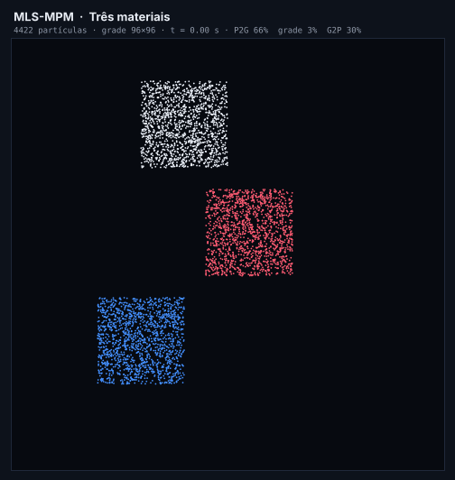
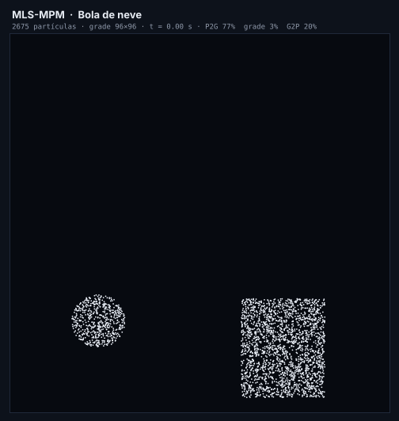

# MLS-MPM 2D em Python

Implementação do núcleo do artigo *A Moving Least Squares Material Point Method with Displacement Discontinuity and Two-Way Rigid Body Coupling* (Hu et al., ACM TOG 37(4), SIGGRAPH 2018).

Trabalho 3, Tópicos Especiais em Computação Gráfica. Equipe: Felype Cesar Molinari, Luiz Antonio Haenisch, Thales Tetsuro Almeida Kuroishi e Isabela Silverio Cardoso Pereira.

 

## Como rodar

```bash
pip install numpy matplotlib
python mls_mpm.py
```

| Tecla / mouse | Ação |
|---|---|
| `1` a `5` | Troca de cena (três materiais, represa, geleias, bola de neve, geleia na água) |
| `espaço` | Pausa ou continua |
| `r` | Reinicia a cena |
| `g` | Mostra a massa acumulada nos nós da grade |
| arrastar (botão esquerdo) | Empurra o material |
| arrastar (botão direito) | Atrai o material |

Opções úteis:

```bash
python mls_mpm.py --cena 4                 # começa na bola de neve
python mls_mpm.py --grade 96               # mais detalhe, mais lento
python mls_mpm.py --salvar demo.gif --quadros 200 --grade 96   # grava sem abrir janela
```

## O que está implementado

- Um passo do MLS-MPM: **P2G** (partícula → grade), **atualização da grade** e **G2P** (grade → partícula), com B-spline quadrática.
- A discretização MLS da força interna: tensão e momento afim (APIC) entram juntos numa única matriz por partícula.
- Três modelos constitutivos: água (fluido), geleia (elástico corotacional) e neve (elastoplástico com endurecimento).
- SVD 2×2 analítica vetorizada, porque `np.linalg.svd` em lote era o gargalo.

A parte de CPIC do artigo (corte de material e acoplamento com corpos rígidos) não foi implementada.

## Desempenho

Só NumPy, sem GPU. Na grade 64×64 (~2 mil partículas) um subpasso leva ~3 ms. Na 96×96 (~4,4 mil partículas), ~7 ms. A janela interativa roda a alguns quadros por segundo, então para a apresentação vale ter os GIFs gravados como reserva.

## Arquivos

| Arquivo | Conteúdo |
|---|---|
| `mls_mpm.py` | Simulador completo (MLS-MPM, cenas, janela interativa e gravação) |
| `midia/*.gif` | Animações gravadas com o próprio código |
| `midia/figura*.png` | Figuras usadas no relatório |

## Referência

HU, Y. et al. *A Moving Least Squares Material Point Method with Displacement Discontinuity and Two-Way Rigid Body Coupling*. ACM Transactions on Graphics, v. 37, n. 4, art. 150, 2018. DOI: [10.1145/3197517.3201293](https://doi.org/10.1145/3197517.3201293).
